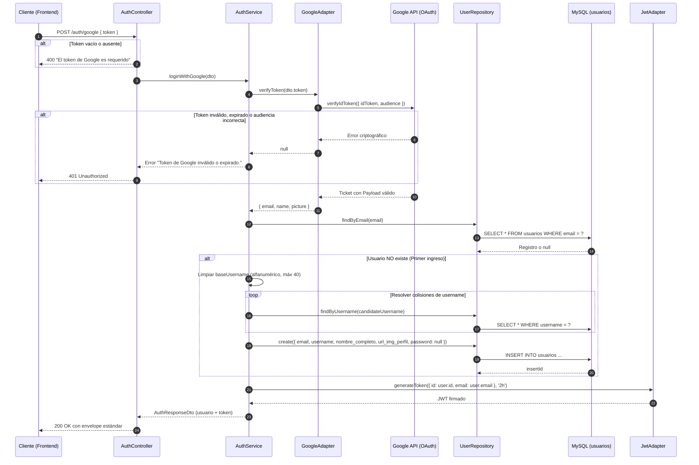

# Documento Técnico: Endpoint de Autenticación con Google (`POST /auth/google`)

Este documento detalla la arquitectura, el flujo de ejecución, el contrato de datos y las consideraciones técnicas para la implementación y refactorización del endpoint de **autenticación federada con Google OAuth 2.0 / OpenID Connect** en la API REST de **TaskMaster**.

---

## 1. Visión General

El endpoint `POST /api/v1/auth/google` permite la autenticación sin contraseña (Single Sign-On). Cumple una doble función transparente para el cliente:

1. **Login (Inicio de sesión)**: Si el correo de Google ya existe en la base de datos, emite inmediatamente el JWT de sesión del sistema.
2. **Registro automático (Sign-up)**: Si el correo nunca antes se registró, crea la cuenta en la tabla `usuarios` (asignando nombre, avatar y un nombre de usuario único) y emite el JWT de sesión en la misma petición.

```
┌─────────────────┐           ┌────────────────────────────┐           ┌──────────────────────┐
│  Frontend / UI  │           │   API REST (TaskMaster)    │           │    Servidores de     │
│ (Google Button) │           │ (Node.js + Express + MySQL)│           │        Google        │
└────────┬────────┘           └─────────────┬──────────────┘           └──────────┬───────────┘
         │                                  │                                     │
         │ 1. Usuario selecciona cuenta     │                                     │
         │─────────────────────────────────►│                                     │
         │    Google emite ID Token         │                                     │
         │◄─────────────────────────────────│                                     │
         │                                  │                                     │
         │ 2. POST /api/v1/auth/google      │                                     │
         │    { token: "<ID_TOKEN>" }       │                                     │
         │─────────────────────────────────►│ 3. verifyIdToken(idToken, audience) │
         │                                  │────────────────────────────────────►│
         │                                  │    Valida firma y emite payload     │
         │                                  │◄────────────────────────────────────│
         │                                  │                                     │
         │                                  │ 4. Busca o Crea usuario en MySQL    │
         │                                  │ 5. Genera JWT interno de TaskMaster │
         │ 6. HTTP 200 OK                   │                                     │
         │    { usuario, token }            │                                     │
         │◄─────────────────────────────────│                                     │
```

---

## 2. Componentes y Arquitectura

La implementación sigue una arquitectura en capas desacopladas:

| Capa | Archivo | Responsabilidad |
| :--- | :--- | :--- |
| **Rutas** | [auth.routes.ts](../src/modules/auth/auth.routes.ts) | Expone la ruta pública `POST /google`. |
| **Controlador** | [auth.controller.ts](../src/modules/auth/auth.controller.ts) | Valida la presencia del `token` en el body y gestiona respuestas HTTP (200, 400, 401, 500). |
| **Servicio** | [auth.service.ts](../src/modules/auth/auth.service.ts) | Orquesta la verificación del token, busca el usuario, resuelve colisiones de `username` y emite el JWT. |
| **Adaptador Google** | [google.adapter.ts](../src/shared/adapters/google.adapter.ts) | Encapsula la librería oficial `google-auth-library` (`OAuth2Client.verifyIdToken`). |
| **Adaptador JWT** | [jwt.adapter.ts](../src/shared/adapters/jwt.adapter.ts) | Genera el token de sesión interno con vigencia de 2 horas. |
| **Repositorio** | [user.repository.ts](../src/modules/users/repositories/user.repository.ts) | Ejecuta las consultas SQL contra la tabla `usuarios` (`findByEmail`, `findByUsername`, `create`). |
| **DTOs** | `google-login.dto.ts`, `auth-response.dto.ts` | Tipado estricto para entrada y salida de datos. |

---

## 3. Variables de Entorno Requeridas

Definidas en el archivo `.env` del backend y en el entorno de producción (Render):

| Variable | Requerida | Ejemplo / Valor | Propósito |
| :--- | :---: | :--- | :--- |
| `GOOGLE_CLIENT_ID` | **Sí** | `1023355026161-v8iv8epaa3hlooui5k44sqocje109sra.apps.googleusercontent.com` | Identificador de cliente OAuth 2.0. El backend lo usa como `audience` para validar que el token fue emitido específicamente para esta aplicación. |
| `JWT_SEED` | **Sí** | `clave_secreta_super_segura` | Semilla para firmar los JSON Web Tokens propios generados por la API. |

> [!IMPORTANT]
> El valor de `GOOGLE_CLIENT_ID` en el `.env` del **Backend** debe ser **idéntico** al configurado en el **Frontend**. Si difieren en un solo caracter, Google rechazará la verificación con el error `Wrong recipient, payload audience != requiredAudience`.

---

## 4. Contrato de la API

### 4.1. Endpoint

```http
POST /api/v1/auth/google
Content-Type: application/json
```

### 4.2. Request Body (`GoogleLoginDto`)

```json
{
  "token": "eyJhbGciOiJSUzI1NiIsImtpZCI6Ij..."
}
```

| Campo | Tipo | Requerido | Descripción |
| :--- | :---: | :---: | :--- |
| `token` | `string` | **Sí** | **ID Token (JWT)** emitido por Google Identity Services (la propiedad `credential`). |

### 4.3. Respuestas

#### Éxito (HTTP `200 OK`):
```json
{
  "success": true,
  "message": "Inicio de sesión con Google exitoso",
  "data": {
    "usuario": {
      "id": 15,
      "correo": "usuario.prueba@gmail.com",
      "nombreUsuario": "usuario_prueba",
      "fotoPerfil": "https://lh3.googleusercontent.com/a/ACg8ocL..."
    },
    "token": "eyJhbGciOiJIUzI1NiIsInR5cCI6IkpXVCJ9..."
  }
}
```

#### Errores Posibles:

| Código HTTP | Escenario | Respuesta JSON |
| :---: | :--- | :--- |
| `400 Bad Request` | No se envió el campo `token` en el body | `{ "success": false, "message": "El token de Google es requerido en el cuerpo de la petición.", "errors": [...] }` |
| `401 Unauthorized` | Token expirado, firma inválida o audiencia no coincidente | `{ "success": false, "message": "Token de Google inválido o expirado.", "errors": ["Token de Google inválido o expirado."] }` |
| `500 Internal Server Error` | Fallo de conexión con la base de datos o error interno | `{ "success": false, "message": "Error interno del servidor", "errors": [...] }` |

---

## 5. Flujo de Ejecución Detallado (Paso a Paso)



---

## 6. Lógica de Refactorización y Buenas Prácticas

### 6.1. Resolución de Colisiones en `username`
La columna `username` tiene restricción `UNIQUE` en la base de datos:
- Si dos usuarios tienen el mismo nombre en Google (ej. *"Carlos Gómez"*), o si ya existe un usuario registrado manualmente con ese nombre, un guardado directo provocaría un error `ER_DUP_ENTRY` (HTTP 500).
- **Algoritmo implementado:**
  1. Se extrae una base alfanumérica en minúsculas del email o nombre (máximo 40 caracteres).
  2. Se consulta con `findByUsername()`.
  3. Si ya existe, se agrega un sufijo incremental (`base1`, `base2`...) hasta hallar un nombre libre.

```typescript
const rawBase = (googlePayload.email.split('@')[0] || googlePayload.name)
    .toLowerCase()
    .replace(/[^a-z0-9_]/g, '')
    .slice(0, 40);
const baseUsername = rawBase.length > 0 ? rawBase : 'user';

let candidateUsername = baseUsername;
let suffix = 1;
while (await this.userService.findUserByUsernameForInternalUse(candidateUsername)) {
    candidateUsername = `${baseUsername.slice(0, 35)}${suffix}`;
    suffix++;
}
```

### 6.2. Atributos Opcionales en Google (`name` y `picture`)
- Google **no garantiza** que el atributo `name` esté siempre presente (depende de la configuración de privacidad de la cuenta).
- Si `payload.name` es `undefined`, se usa como respaldo el prefijo del correo (`payload.email.split('@')[0]`).
- La columna `url_img_perfil` en la base de datos es `VARCHAR(255)`. Las URLs de imagen de Google se recortan de forma segura (`slice(0, 255)`) para prevenir errores de tipo `Data too long for column`.

### 6.3. Cuentas Federadas y Contraseñas
- Los usuarios registrados con Google se insertan con `password = NULL`.
- Por diseño de seguridad, si este usuario intenta usar el endpoint de cambio de contraseña local (`/auth/request-password-change`), el sistema lo bloquea con un `400 Bad Request`: *"Tu cuenta usa Google para iniciar sesión. No posee contraseña local."*

---

## 7. Guía de Integración para el Frontend

### 7.1. Carga del SDK de Google Identity Services
En el archivo HTML principal (ej. `index.html` o `login.html`):

```html
<script src="https://accounts.google.com/gsi/client" async defer></script>
```

### 7.2. Implementación en JavaScript

```javascript
const GOOGLE_CLIENT_ID = '1023355026161-v8iv8epaa3hlooui5k44sqocje109sra.apps.googleusercontent.com';
const API_URL = 'http://localhost:3000/api/v1/auth/google';

// 1. Inicializar el botón de Google
function inicializarGoogleSignIn() {
  google.accounts.id.initialize({
    client_id: GOOGLE_CLIENT_ID,
    callback: manejarRespuestaGoogle
  });

  google.accounts.id.renderButton(
    document.getElementById('contenedor-boton-google'),
    { theme: 'outline', size: 'large', text: 'continue_with', width: 280 }
  );
}

// 2. Callback que recibe la credencial de Google
async function manejarRespuestaGoogle(response) {
  // response.credential es el ID Token (JWT)
  const idToken = response.credential;

  try {
    const res = await fetch(API_URL, {
      method: 'POST',
      headers: { 'Content-Type': 'application/json' },
      body: JSON.stringify({ token: idToken })
    });

    const data = await res.json();

    if (!res.ok) {
      throw new Error(data.message || 'Error al autenticar con Google');
    }

    // 3. Guardar el token de sesión de TaskMaster
    localStorage.setItem('token', data.data.token);
    localStorage.setItem('usuario', JSON.stringify(data.data.usuario));

    // 4. Redirigir al dashboard / proyectos
    window.location.href = '/src/pages/proyectos/proyectos.html';

  } catch (error) {
    console.error('Fallo en autenticación:', error.message);
    mostrarMensajeError(error.message);
  }
}
```

---

## 8. Diagnóstico de Problemas Comunes

| Síntoma | Causa Técnica | Solución |
| :--- | :--- | :--- |
| `401 Token de Google inválido o expirado.` | Se envió un `access_token` en lugar de un `id_token`. | Asegurar que el frontend envíe `response.credential` proveniente de `google.accounts.id.initialize`. |
| `Error: Wrong recipient, payload audience != requiredAudience` en consola backend | El Client ID del frontend no es idéntico al `GOOGLE_CLIENT_ID` del backend. | Revisar y unificar el Client ID en ambos lados. |
| Popup de Google se cierra solo con error de origen | El origen del frontend (ej. `http://localhost:5500`) no está autorizado. | Agregar la URL completa en *Google Cloud Console $\rightarrow$ Credenciales $\rightarrow$ Orígenes de JavaScript autorizados*. |
| `500 Internal Server Error` al registrar nuevo usuario | Falla de inserción por campos `NOT NULL` o colisión. | Verificar que `username` se genere de forma única y que `nombre_completo` admita valores opcionales. |
